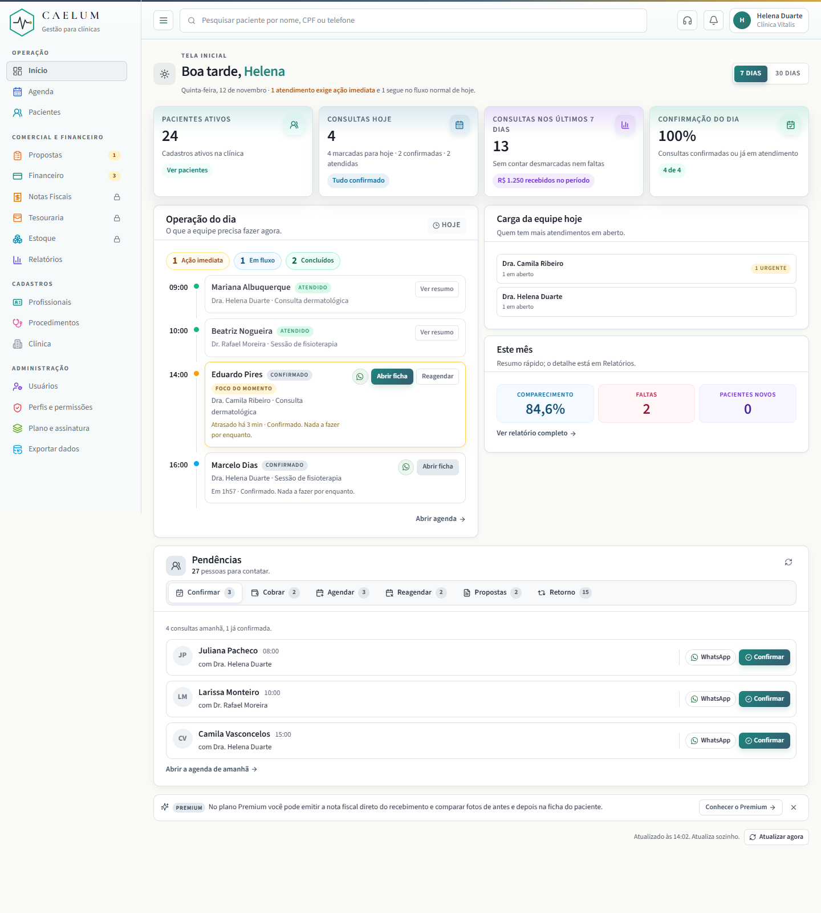
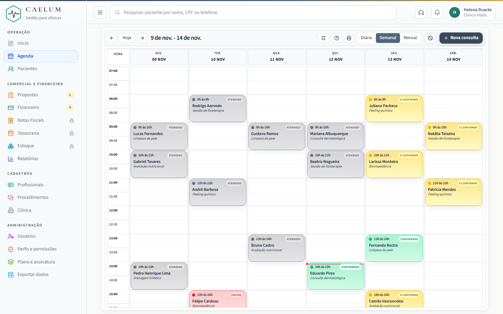
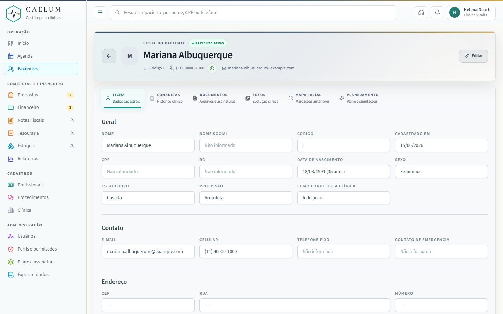
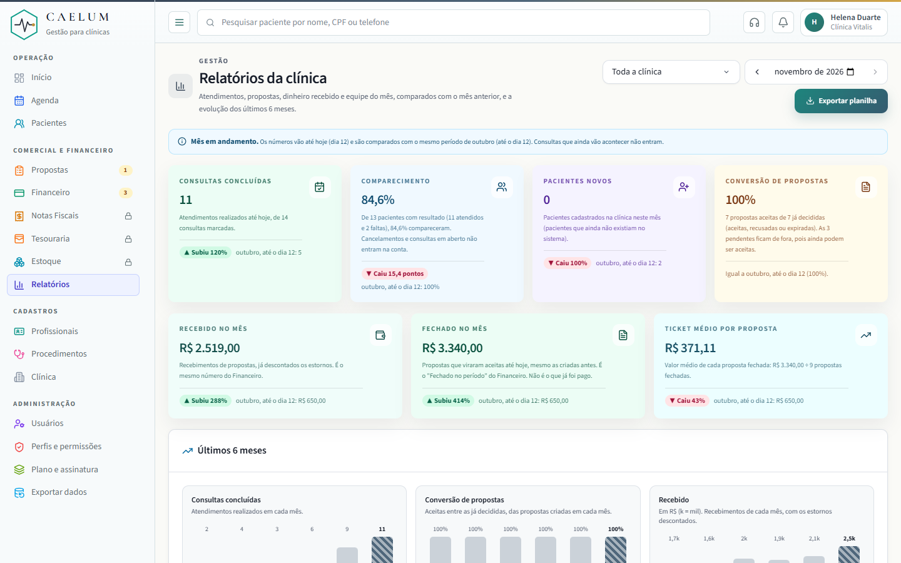
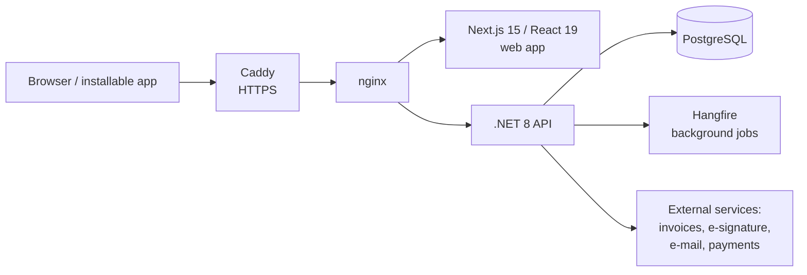

# Caelum — clinic management SaaS

[Leia em português](README.pt-BR.md)

Caelum is a SaaS for small clinics in Brazil, covering scheduling, patient records, proposals, payments, accounts payable, inventory and reports. It is in production with clinics using it. I designed and built it alone, with AI as my main development tool.

**This repository is a showcase.** Caelum is a commercial product, so the source code is private. Code walkthrough and live demo are available on request.

| | |
| --- | --- |
| Built by | 1 person, AI-first |
| Time | about 2 months (Sep–Nov 2026) |
| Commits | 490 |
| API controllers | 52 |
| Database migrations | 100+ |
| End-to-end test scripts | 62 |

## Screenshots

> All screenshots use demo data. No real patient data is shown.

| Home: "Who to call" | Schedule |
| --- | --- |
|  |  |

| Patient record | Reports |
| --- | --- |
|  |  |

## Product decisions

The hardest part was not the code but deciding what to build. A few examples:

**1. The home screen answers "who should I call today, and why?"**
Front desks had no action list: open proposals, unpaid balances and procedures without a date were hidden in small shortcuts. I replaced the dashboard with a "Who to call" panel of six queues: confirm, collect payment, schedule, reschedule, open proposals and follow-ups. Each queue has explicit entry rules, for example:
- an unpaid balance enters when the procedure is done, 2 days before the appointment, or 7 days after closing with no appointment;
- a follow-up enters when a procedure with a suggested return is finished, and leaves 90 days after the due date;
- a patient already called comes back after 3 days;
- "collect payment" can only be snoozed, never dismissed, because money does not disappear with a click.

**2. Two plans, add-ons and a fair price-change policy.**
Two plans (Basic and Premium) with unlimited users, features gated by plan, and paid add-ons per clinic. Price increases need 30 days' notice, while decreases apply immediately. Each clinic's price is decided by what it actually pays.

**3. Cutting scope on purpose.**
Finance stays at gross revenue: no taxes, costs or supplies. Small clinics need to know what came in and what is owed, while full accounting slows them down and belongs to their accountant.

**4. Clinical vs. operational data.**
Appointment notes are operational, and clinical notes live only in the patient record. Outbound messages never mention procedures or health data. This keeps sensitive data where permissions and LGPD rules apply.

## How I verify: the cross-clinic data leak

All clinics share one database, so every query must be filtered by clinic. I assumed this was working. Instead of trusting the assumption, I wrote a test where one clinic acts as an attacker and tries to **read and change** data from two other clinics.

- **Result of the first run:** 16 of 45 probes leaked, including patient records, clinical notes and documents. The global clinic filter was built once at startup, when no clinic was logged in, so it never applied.
- **Fix:** a per-request clinic filter on every clinic-owned entity, a guard on save that refuses to write another clinic's data, and an explicit clinic check on the affected routes.
- **Now:** 45 probes, 0 leaks. The test runs before every release.

The system was not yet public when this was found, so no real data was exposed.

## Architecture

- **Backend:** C# / .NET 8, Entity Framework Core, PostgreSQL, Hangfire
- **Frontend:** Next.js 15, React 19, TypeScript, installable as an app (PWA)
- **Infra:** Docker Compose, Caddy, nginx, self-managed VPS, automated backups
- **Integrations:** Focus NFe (service invoices), Autentique (digital signatures), e-mail delivery, payment gateway
- **Security and privacy:** role-based permissions with custom roles, LGPD data export and retention, security audits, rate-limited login

## Features

- Scheduling with blocks, holidays and working hours per professional
- Patient records, anamnesis, clinical notes and before/after photos
- Proposals that turn into scheduled procedures and payments
- Payments, receipts and service invoices
- Accounts payable with calendar and cash-flow report
- Inventory with lots, expiry dates, cost and margin per procedure
- Document templates and digital signatures
- Custom roles: nobody can grant a permission they do not have
- AI scribe prototype for clinical notes (speech-to-text + LLM), not yet released

## About me

Maurício Andreas dos Santos, Apucarana, Brazil. B.S. in Information Systems, former NF-e developer, now founder of Caelum. Contact: mauricioandreass@gmail.com
