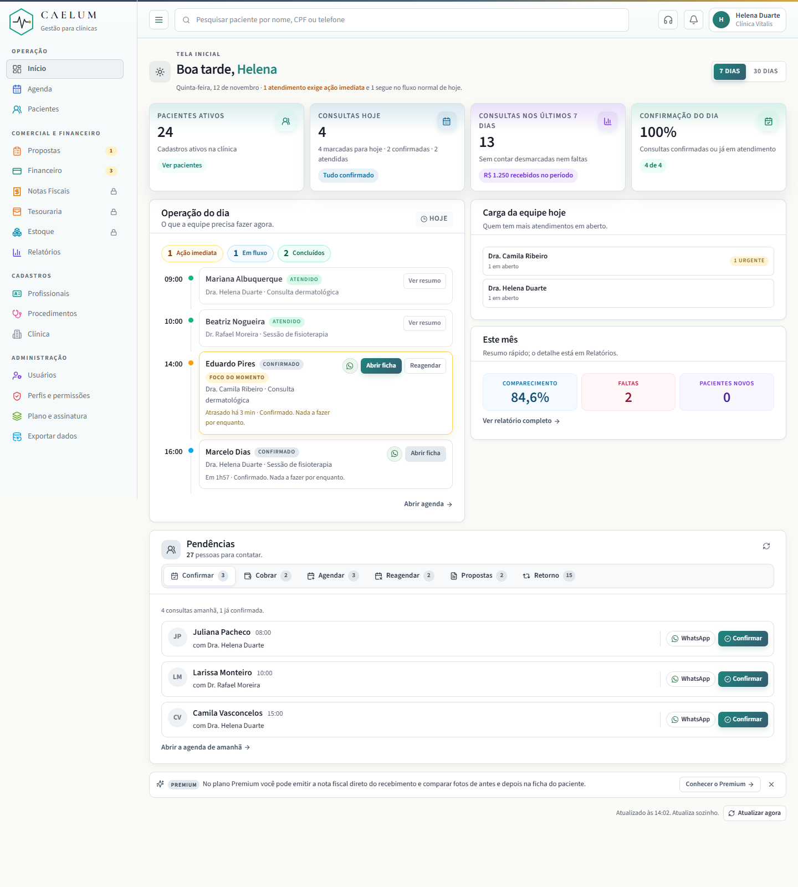
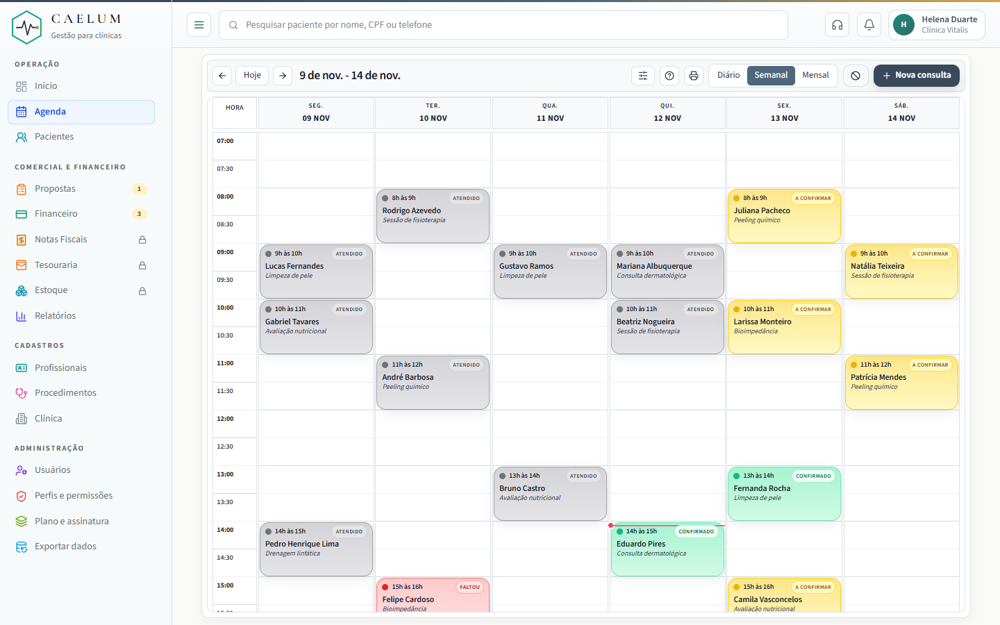
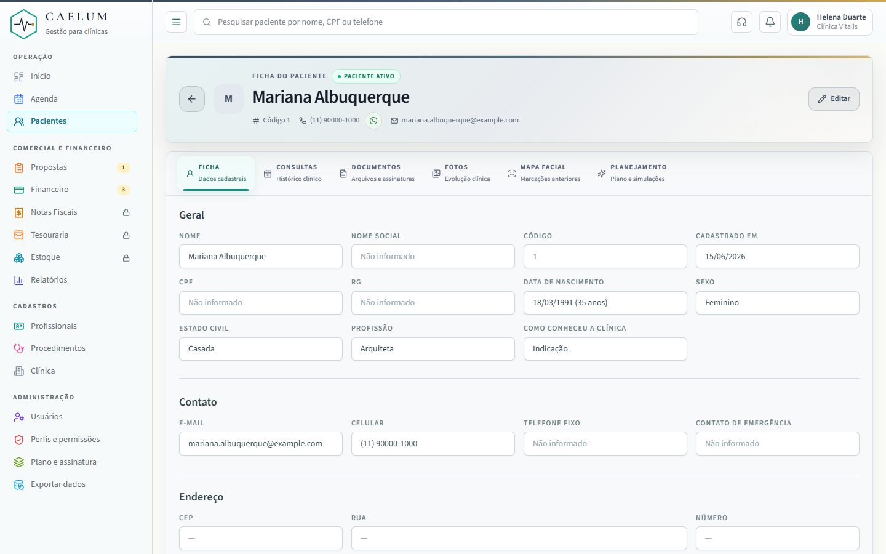
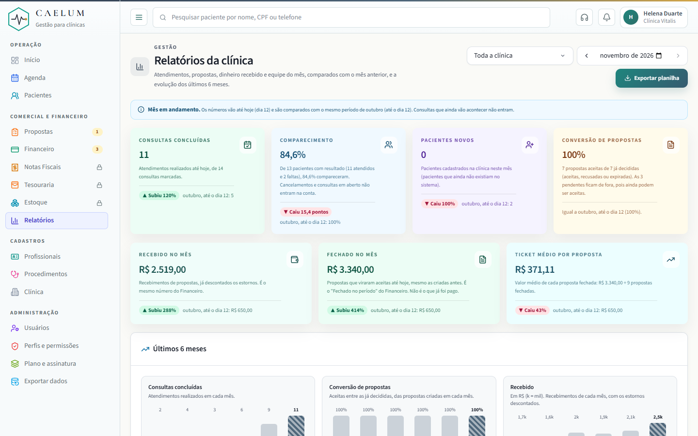
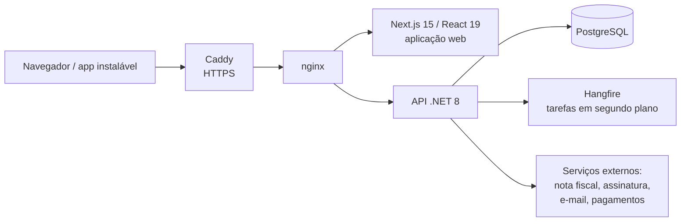

# Caelum — sistema de gestão para clínicas

[Read in English](README.md)

O Caelum é um SaaS para pequenas clínicas, com agenda, prontuário, propostas, pagamentos, contas a pagar, estoque e relatórios. Está em produção, com clínicas usando. Desenhei e construí tudo sozinho, com IA como ferramenta principal de desenvolvimento.

**Este repositório é uma vitrine.** O Caelum é um produto comercial, então o código-fonte é privado. Código e demonstração ao vivo estão disponíveis mediante solicitação.

| | |
| --- | --- |
| Feito por | 1 pessoa, com IA |
| Tempo | cerca de 2 meses (set–nov 2026) |
| Commits | 490 |
| Controladores de API | 52 |
| Migrações de banco | mais de 100 |
| Roteiros de teste de ponta a ponta | 62 |

## Telas

> Todas as telas usam dados de demonstração. Nenhum dado real de paciente aparece.

| Tela inicial: "Quem chamar" | Agenda |
| --- | --- |
|  |  |

| Prontuário | Relatórios |
| --- | --- |
|  |  |

## Decisões de produto

A parte mais difícil não foi o código, e sim decidir o que construir. Alguns exemplos:

**1. A tela inicial responde "quem eu chamo hoje, e por quê?"**
A recepção não tinha uma lista de ação: propostas em aberto, saldos a receber e procedimentos sem data ficavam escondidos em atalhos pequenos. Troquei o painel por "Quem chamar", com seis filas: confirmar, cobrar, agendar, reagendar, propostas e retornos. Cada fila tem regras claras de entrada, por exemplo:
- o saldo a receber entra quando o procedimento é realizado, 2 dias antes da consulta, ou 7 dias depois de fechar sem consulta marcada;
- o retorno entra quando termina um procedimento com retorno sugerido, e sai 90 dias depois do prazo;
- quem já foi chamado volta para a lista depois de 3 dias;
- "cobrar" só pode ser adiado, nunca dispensado, porque dinheiro não some com um clique.

**2. Dois planos, upgrades e uma política de preço justa.**
Dois planos (Básico e Premium) com usuários ilimitados, recursos liberados por plano e upgrades pagos por clínica. Aumento de preço exige 30 dias de aviso, e redução vale na hora. O preço de cada clínica é decidido pelo que ela de fato paga.

**3. Cortar escopo de propósito.**
O financeiro fica no valor bruto: sem impostos, custos ou insumos. A pequena clínica precisa saber o que entrou e o que está para pagar. Contabilidade completa só atrapalha e é trabalho do contador.

**4. Dado clínico separado do operacional.**
A observação da agenda é operacional, e a anotação clínica fica só no prontuário. As mensagens enviadas ao paciente nunca citam procedimento nem dado de saúde. Assim o dado sensível fica onde valem as permissões e a LGPD.

## Como eu confiro: o vazamento entre clínicas

Todas as clínicas dividem o mesmo banco de dados, então toda consulta precisa ser filtrada por clínica. Eu supunha que isso funcionava. Em vez de confiar na suposição, escrevi um teste em que uma clínica faz o papel de atacante e tenta **ler e alterar** dados de outras duas.

- **Resultado da primeira rodada:** 16 de 45 sondas vazaram, incluindo prontuário, anotações clínicas e documentos. O filtro global era montado uma única vez, na partida do sistema, quando nenhuma clínica estava logada, e por isso nunca era aplicado.
- **Correção:** filtro por clínica a cada requisição em todas as tabelas da clínica, uma trava na gravação que recusa salvar dado de outra clínica e uma checagem explícita nas rotas afetadas.
- **Hoje:** 45 sondas, 0 vazamentos. O teste roda antes de cada publicação.

O sistema ainda não era público quando isso foi encontrado, então nenhum dado real foi exposto.

## Arquitetura

- **Back-end:** C# / .NET 8, Entity Framework Core, PostgreSQL, Hangfire
- **Front-end:** Next.js 15, React 19, TypeScript, instalável como aplicativo (PWA)
- **Infraestrutura:** Docker Compose, Caddy, nginx, servidor próprio (VPS), backups automáticos
- **Integrações:** Focus NFe (nota fiscal de serviço), Autentique (assinatura digital), envio de e-mail, gateway de pagamento
- **Segurança e privacidade:** permissões por perfil com perfis personalizados, exportação e retenção de dados (LGPD), auditorias de segurança, limite de tentativas de login

## Funcionalidades

- Agenda com bloqueios, feriados e horários por profissional
- Prontuário, anamnese, anotações clínicas e fotos de antes e depois
- Propostas que viram procedimentos agendados e pagamentos
- Pagamentos, recibos e nota fiscal de serviço
- Contas a pagar com calendário e relatório de entradas e saídas
- Estoque com lotes, validade, custo e margem por procedimento
- Modelos de documento e assinatura digital
- Perfis personalizados: ninguém concede uma permissão que não tem
- Protótipo de escriba com IA para anotações clínicas (transcrição de voz + modelo de linguagem), ainda não lançado

## Sobre mim

Maurício Andreas dos Santos, Apucarana/PR. Bacharel em Sistemas de Informação, ex-desenvolvedor de NF-e, hoje fundador do Caelum. Contato: mauricioandreass@gmail.com
